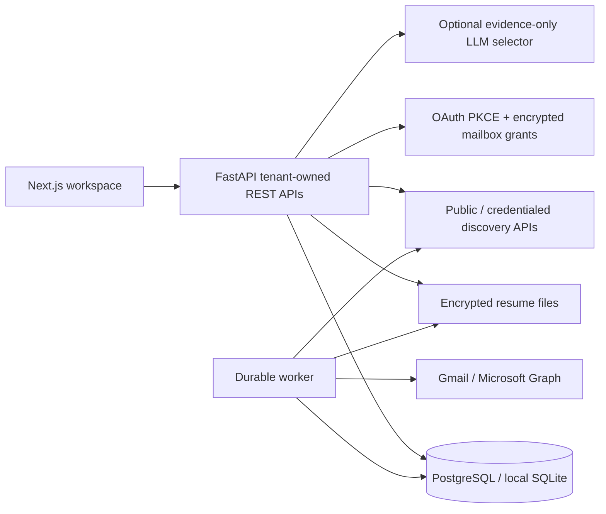

# Architecture

## Persistent entities

`users`, `sessions`, `user_profiles`, `resume_files`, `campaigns`, `opportunity_listings`, `contacts`, `email_drafts`, `campaign_approvals`, `mailboxes`, `oauth_states`, `sending_queue`, `email_messages`, `replies`, `suppression_list`, `applications`, `audit_logs`, `api_usage`, `scheduled_research`, `notifications`, `follow_ups`.

Education, experiences, skills, interests and projects are structured JSON arrays inside the owned profile; preferences are versioned JSON on the campaign; provider/source and compensation metadata are on each opportunity. Resume versions are separate immutable approved file records. Company identity is a normalized key on each listing/contact/message. Verification status/date is stored directly on contacts. Threads are provider IDs on messages. This compact model deliberately does not create a separate table for every noun in the product brief.

Foreign keys and user/campaign ownership protect access. Unique indexes prevent source duplicates, duplicate draft/opportunity pairs, repeated initial company/recipient sends, duplicate provider replies, duplicate mailbox bindings and multiple follow-ups. Normalized company names are conservative but imperfect: subsidiaries, aliases and similarly named companies require user review; verified legal-domain entity resolution is future work.

## Research

API-only adapters return source-backed records. Public board membership is evidence of an active source vacancy, not independent certification of the company's legitimacy. Google Jobs leads remain unverified. Closed/expired/unverified leads cannot dispatch. Scheduled searches update retrieved evidence and invalidate approvals when content/eligibility changes. A missing listing is not automatically classified closed because a provider response may be partial. Dispatch rejects evidence older than 24 hours.

Matching uses the requested 25/20/15/15/10/10/5 weights. API clients can configure weights summing to 100. Hard exclusions include explicit incompatibility, excluded geography, deadline, blacklist, category and compensation policy. Missing eligibility remains “not verified,” not proof of eligibility. Distinct specialized internship categories require explicit title evidence. Compensation keeps the source currency and frequency; unknown currency/frequency comparisons are neutral rather than guessed. Frankfurter daily rates compare different currencies only when the payment period matches, retaining the original values, rate source and date. An unavailable rate leaves the comparison unverified.

## Personalization

Default writing is deterministic and extractive: exact opportunity title/company, a source excerpt, and skills found in both the confirmed profile and approved original resume. The optional provider adapter can select evidence indexes only. The user can edit the draft, and assumes responsibility for added claims. Heuristic checks are not a semantic proof that arbitrary human edits contain no invented claims.

## Authorization

Approvals bind campaign revision/preferences and the exact draft subject/body/contact/resume identifiers through a SHA-256 scope digest. Profile changes, campaign changes and draft edits revoke the scope. The worker revalidates digest, profile confirmation, resume approval/integrity, contact verification, source freshness, quotas, dates, sending hours, duplicates and suppression before dispatch. The present autopilot mode does not grant criteria-wide authority to contact unseen recipients.

## Queue

The queue is stored in the application database, using PostgreSQL row locks with skip-locked selection and per-user serialization. Processes can restart without losing jobs. No Redis is required. A sending marker precedes the external side effect. Ambiguous outcomes become unknown and require reconciliation; there is no claim of exactly-once email delivery. Initial outreach is unique by user/company and user/recipient; at most one separately authorized follow-up is allowed per initial message.
